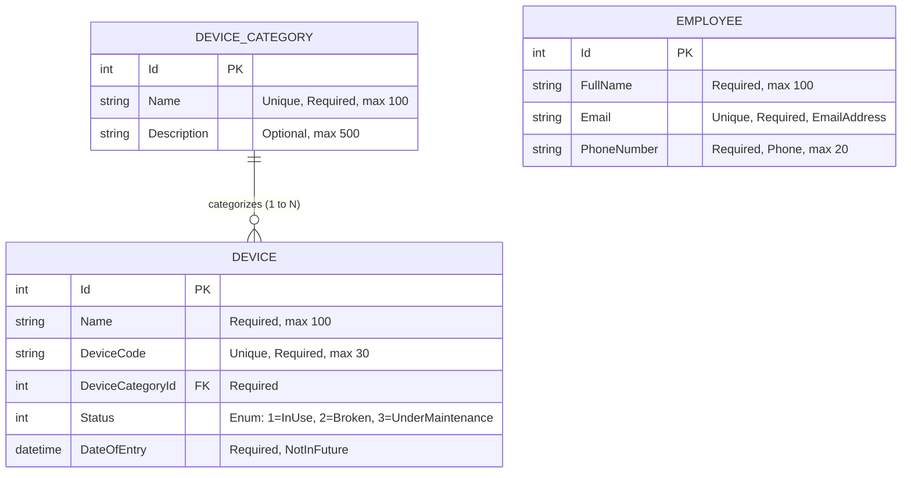

# Implementation Plan: Device Management System

**Project:** Device Management Software  
**Framework:** ASP.NET Core 8.0 MVC  
**Database:** Microsoft SQL Server (LocalDB / Express / Enterprise) via Entity Framework Core 8.0  

---

## 1. System Architecture

The solution uses a standard, clean ASP.NET Core MVC architecture with a dedicated Unit Test project:

```
d:\Lab1_CSE_422\Lab2\
├── DeviceManagement.sln               # Visual Studio Solution File
├── docs/                             # Architecture & Project Documentation
│   ├── ASSIGNMENT_ANALYSIS.md
│   ├── LECTURE_CONCEPTS.md
│   ├── IMPLEMENTATION_PLAN.md
│   ├── PROJECT_REPORT.md
│   ├── REQUIREMENTS_CHECKLIST.md
│   └── LEARNING_GUIDE.md
├── DeviceManagement/                 # Main ASP.NET Core 8 MVC Project
│   ├── Controllers/
│   │   ├── HomeController.cs
│   │   ├── DeviceCategoriesController.cs
│   │   ├── DevicesController.cs
│   │   └── EmployeesController.cs
│   ├── Data/
│   │   ├── DeviceManagementContext.cs
│   │   └── DbInitializer.cs
│   ├── Models/
│   │   ├── Device.cs
│   │   ├── DeviceCategory.cs
│   │   ├── Employee.cs
│   │   ├── DeviceStatus.cs
│   │   └── ValidationAttributes/
│   │       └── NotInFutureAttribute.cs
│   ├── ViewModels/
│   │   ├── DeviceIndexViewModel.cs
│   │   └── DashboardViewModel.cs
│   ├── Views/
│   │   ├── Home/
│   │   │   ├── Index.cshtml
│   │   │   └── Privacy.cshtml
│   │   ├── DeviceCategories/
│   │   │   ├── Index.cshtml
│   │   │   ├── Details.cshtml
│   │   │   ├── Create.cshtml
│   │   │   ├── Edit.cshtml
│   │   │   └── Delete.cshtml
│   │   ├── Devices/
│   │   │   ├── Index.cshtml
│   │   │   ├── Details.cshtml
│   │   │   ├── Create.cshtml
│   │   │   ├── Edit.cshtml
│   │   │   └── Delete.cshtml
│   │   ├── Employees/
│   │   │   ├── Index.cshtml
│   │   │   ├── Details.cshtml
│   │   │   ├── Create.cshtml
│   │   │   ├── Edit.cshtml
│   │   │   └── Delete.cshtml
│   │   └── Shared/
│   │       ├── _Layout.cshtml
│   │       ├── _ViewStart.cshtml
│   │       ├── _ViewImports.cshtml
│   │       ├── _ValidationScriptsPartial.cshtml
│   │       └── _Alerts.cshtml
│   ├── wwwroot/
│   │   ├── css/site.css
│   │   ├── js/site.js
│   │   └── lib/ (bootstrap, jquery, jquery-validation)
│   ├── Migrations/
│   ├── appsettings.json
│   ├── appsettings.Development.json
│   ├── Program.cs
│   └── DeviceManagement.csproj
└── DeviceManagement.Tests/           # Automated Test Project (.NET 8 xUnit)
    ├── DeviceValidationTests.cs
    ├── DeviceFilterTests.cs
    ├── EmployeeValidationTests.cs
    └── DeviceManagement.Tests.csproj
```

---

## 2. Database Schema & Entity Relationships

### 2.1 Entity Relationship Diagram



### 2.2 Data Integrity Rules
1. **Cascade Delete Restriction:**
   Deleting a `DeviceCategory` that contains active devices is blocked at the database level (`DeleteBehavior.Restrict`) and pre-checked in `DeviceCategoriesController.Delete` with an explanatory message.
2. **Unique Identifiers:**
   - `DeviceCategory.Name`: Unique index.
   - `Device.DeviceCode`: Unique index.
   - `Employee.Email`: Unique index.
3. **Status Constraints:**
   - Managed via C# `DeviceStatus` enum with integer backing in SQL Server.

---

## 3. Development Stages & Milestones

| Stage | Focus Area | Deliverables & Verification |
|---|---|---|
| **Stage 1** | Research & Analysis | Complete planning documents (`ASSIGNMENT_ANALYSIS.md`, `LECTURE_CONCEPTS.md`, `IMPLEMENTATION_PLAN.md`). |
| **Stage 2** | Solution & Project Setup | Configure .NET 8 MVC project `DeviceManagement`, create `.sln`, configure NuGet packages (`Microsoft.EntityFrameworkCore.SqlServer`, `Microsoft.EntityFrameworkCore.Design`). |
| **Stage 3** | Models, Context & Database | Implement models (`DeviceCategory`, `Device`, `Employee`, `DeviceStatus`, `NotInFutureAttribute`), create `DeviceManagementContext`, create initial EF Core migration, create `DbInitializer` with sample data. |
| **Stage 4** | Controllers, ViewModels & Views | Implement controllers with CRUD actions, search, and filters. Build Razor views with Bootstrap 5 styling, status badges, flash messages, and dropdowns. |
| **Stage 5** | Automated Tests & Quality Review | Create `DeviceManagement.Tests`, implement unit tests for validations and queries, execute `dotnet test`, ensure clean build with zero warnings/errors. |
| **Stage 6** | Comprehensive Documentation | Write `README.md`, `docs/PROJECT_REPORT.md`, `docs/REQUIREMENTS_CHECKLIST.md`, and `docs/LEARNING_GUIDE.md`. |
| **Stage 7** | Final Verification & Delivery | Verify application execution against LocalDB, verify routes, and package step-by-step submission instructions. |

---

## 4. Query & Search Strategy

Devices search and filtering will be constructed using composable LINQ queries on `IQueryable<Device>`:

```csharp
var query = _context.Devices
    .Include(d => d.DeviceCategory)
    .AsNoTracking()
    .AsQueryable();

if (!string.IsNullOrWhiteSpace(searchString))
{
    var trimmed = searchString.Trim();
    query = query.Where(d => d.Name.Contains(trimmed) || d.DeviceCode.Contains(trimmed));
}

if (status.HasValue)
{
    query = query.Where(d => d.Status == status.Value);
}

if (categoryId.HasValue && categoryId.Value > 0)
{
    query = query.Where(d => d.DeviceCategoryId == categoryId.Value);
}
```

This guarantees:
1. Filters run directly on the database engine.
2. Search is case-insensitive (default SQL Server collation).
3. Eager loading via `.Include(...)` loads the related category in a single join query.
4. `.AsNoTracking()` improves memory performance for read-only listings.
